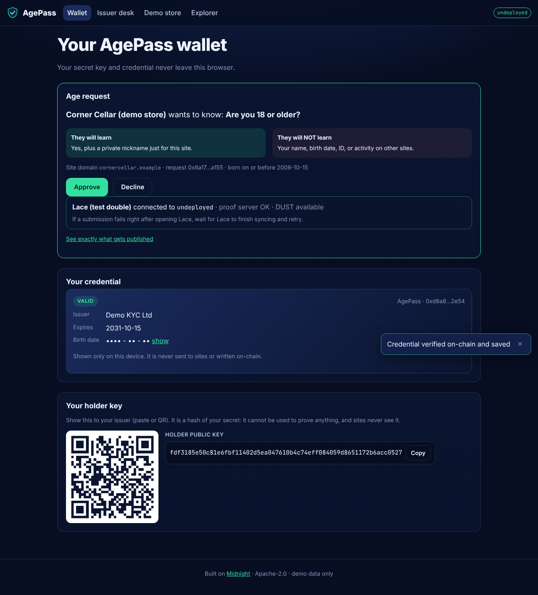
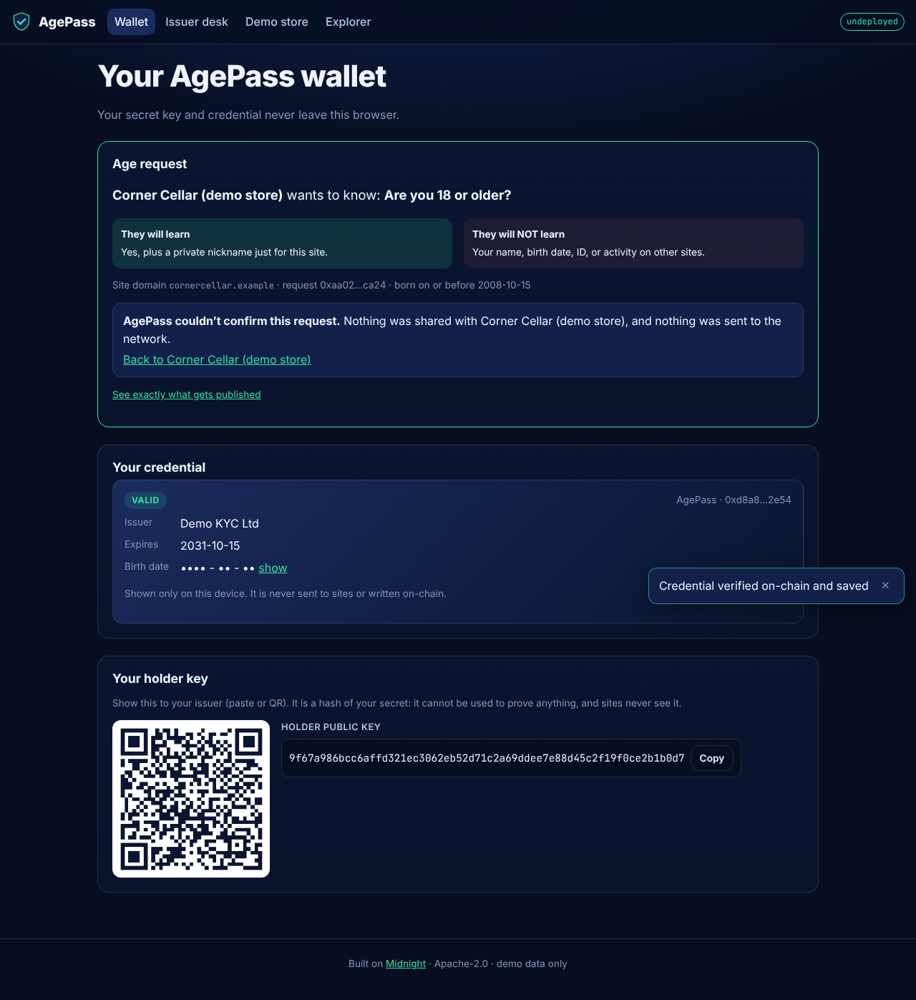
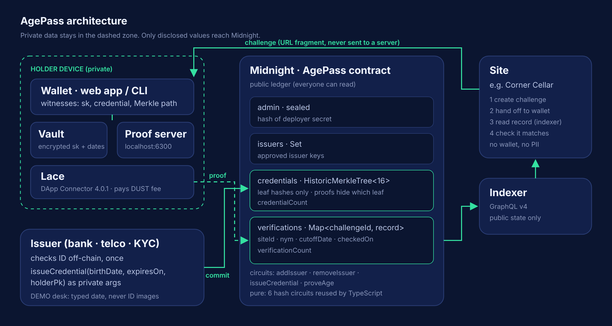
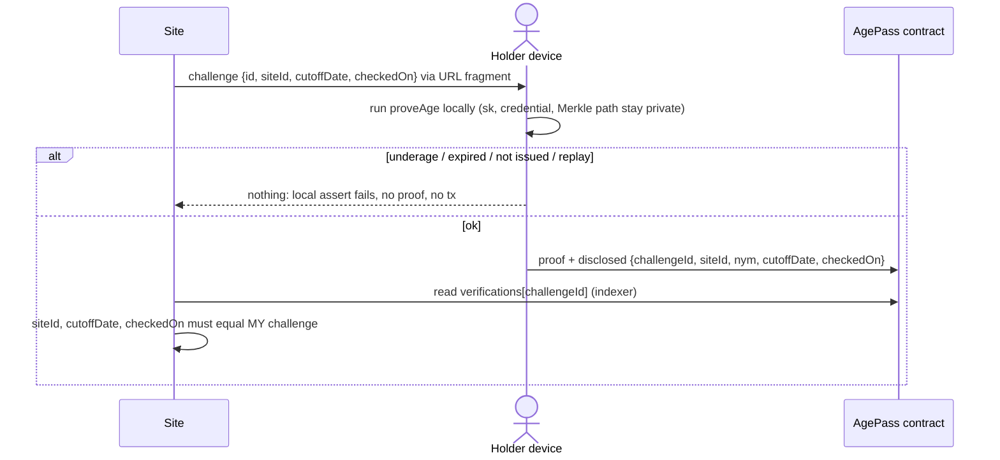

# AgePass

**Prove you’re 18+. Not who you are.** Zero-knowledge age credentials on Midnight.

[](https://github.com/Emediong-Etuk/AgePass/actions/workflows/ci.yml)
[](LICENSE)


> Built on [Midnight](https://midnight.network) for the Midnight Network Buildathon (Wave 1).
> Demo data only: AgePass never accepts real ID documents.

| Pitch deck                                                              | Demo video                                                         | Contract (Preview)                           |
| ----------------------------------------------------------------------- | ------------------------------------------------------------------ | -------------------------------------------- |
| [`docs/pitch/deck.md`](docs/pitch/deck.md) · [PDF](docs/pitch/deck.pdf) | _link added after recording_ ([script](docs/pitch/demo-script.md)) | `54fc78d889…1069d2` ([details](#deployment)) |

---

## 1. The problem

Age-check rules are spreading (UK, EU, Australia, many US states). Today, proving you are 18
means **uploading a passport or a face scan to every site**. Each site only needs _yes or no_,
but ends up holding full identities that get breached, sold or kept forever.

## 2. The solution

1. **Verify once.** A trusted issuer (KYC provider, bank, telco) checks your ID one time and
   adds a hidden **commitment** to a Merkle tree on Midnight. Your birth date never goes on-chain.
2. **Prove anywhere.** When a site asks “18+?”, your device proves in zero knowledge that it
   holds _some_ issued credential, that it hasn’t expired, and that the birth date inside is on
   or before the site’s cutoff.
3. **The site learns “yes”**, plus a **site-specific nickname** `nym = H(secret, site)`: stable on
   that site, unlinkable across sites, and not computable even by the issuer.

| The holder approves a request                       | The store unlocks and shows the exact public record |
| --------------------------------------------------- | --------------------------------------------------- |
|  |    |

An underage holder is stopped **on their own device** before a proof exists: nothing is sent.


---

## 3. Judge quick start

Prerequisites: **Node ≥ 22**, git, and the Compact toolchain pinned to the version the public
networks support:

```bash
curl --proto '=https' --tlsv1.2 -LsSf https://github.com/midnightntwrk/compact/releases/download/compact-v0.5.1/compact-installer.sh | sh
compact update 0.31.1          # NOT a bare `compact update` (0.34+ targets ledger 9)
compact compile --version      # 0.31.1
```

### (a) 2 minutes: compile and test, no Docker, no wallet

```bash
git clone https://github.com/Emediong-Etuk/AgePass && cd AgePass
npm ci
npm run compact      # compiles agepass.compact, generates ZK keys (~30 s)
npm test             # 33 contract spec tests (simulator) + 67 SDK tests
```

### (b) 10 minutes: the whole story on a local Midnight network (Docker)

```bash
npm run devnet:up    # node 1.0.400 + indexer 4.3.5 + proof server 8.1.3, pinned to the matrix
npm run demo:local   # deploy, approve issuer, issue to Ada (adult) and Max (16), prove, block, replay, 2nd site
npm run e2e:local    # same flow with assertions; exit code 0/1
npm run devnet:down
```

Expected highlights (full run: [`docs/evidence/e2e-local.txt`](docs/evidence/e2e-local.txt)):

```text
━━ 5. Ada proves she is 18+ with a zero-knowledge proof ━━━━━━━━━━━━━━━━
✅ verified at cornercellar.example: welcome, nym 0x51c9db…4ee36c
━━ 6. Max (16) tries the same store ━━━━━━━━━━━━━━━━━━━━━━━━━━━━━━━━━━━━
❌ AgePass couldn't confirm this request. (age requirement not met)
  transactions sent for this attempt: 0. Nothing reached the chain.
━━ 8. Ada visits a different site: a new, unlinkable nickname ━━━━━━━━━━
  Corner Cellar:   nym 0x51c9db…4ee36c
  Pixel Arcade:    nym 0xf265bf…1e93ad
✅ Scanned 2567 bytes of public state: no birth dates, holder keys or secrets.
✅ e2e: all checks passed
```

Optional: `npm run e2e:ui` drives the web app in Chromium against the local devnet (issue →
import → prove → unlock → underage blocked) and writes the screenshots in `docs/img/`.

### (c) The live web app on Preview

1. Install **Lace** (Chrome), create a Midnight wallet, switch it to **Preview**, set the proof
   server to `http://localhost:6300`, get tNIGHT from the
   [Preview faucet](https://midnight-tmnight-preview.nethermind.dev/) and register it for DUST.
2. Run a local proof server (Lace needs one):
   `docker run -p 6300:6300 midnightntwrk/proof-server:8.1.3 midnight-proof-server -v`
3. `npm run app:dev` and open the printed URL (or a hosted build), then follow the
   landing page: **Wallet** → **Issuer desk** → **Demo store** → **Explorer**.
   Use two Chrome profiles to play issuer and holder.

For local UI work against the devnet: `VITE_NETWORK_ID=undeployed npm run app:dev`.

---

## 4. How privacy shapes the design

| Data                                                      | On-chain?                                                              |
| --------------------------------------------------------- | ---------------------------------------------------------------------- |
| Name, ID document                                         | Never collected by AgePass                                             |
| Birth date, expiry, holder secret, holder key             | **Never.** Private circuit inputs only                                 |
| The credential commitment                                 | **Never visible.** The tree stores a leaf hash; proofs hide which leaf |
| Approved issuer keys, admin key, counts                   | Public, for accountability                                             |
| `challengeId`, `siteId`, `nym`, `cutoffDate`, `checkedOn` | Public: the site’s “yes”                                               |

The nine design invariants, in plain language:

1. Your birth date leaves your device only once, to the issuer. Never on-chain, never in logs.
2. Your secret key never leaves your device.
3. A verification reveals only the challenge, the site, your site nickname and the two dates
   the site asked about, never which credential you used.
4. Same person + same site ⇒ same nickname; different sites ⇒ unlinkable; different people ⇒
   different nicknames.
5. Only approved issuers can add credentials; only the admin manages issuers.
6. Each challenge can be answered once.
7. Failure leaks nothing: an underage, expired or forged attempt fails locally and sends nothing.
8. TypeScript never re-implements a hash; it calls the contract’s exported pure circuits.
9. Dates are `YYYYMMDD` integers; the circuit only compares numbers.

Full model: [`docs/privacy-model.md`](docs/privacy-model.md) (field-by-field and per
transaction, including what DUST fees reveal) · [`docs/threat-model.md`](docs/threat-model.md).

---

## 5. Midnight integration

| Midnight feature                | How AgePass uses it                                                                                                                                                                                    |
| ------------------------------- | ------------------------------------------------------------------------------------------------------------------------------------------------------------------------------------------------------ |
| **Dual ledger**                 | Public: `admin`, `issuers`, `credentials`, `verifications`, counters. Private: the holder’s `sk` and credential in local private state (encrypted level DB in the CLI, encrypted vault in the browser) |
| **Witnesses**                   | `localSecretKey()`, `storedCredential()`, `credentialPath(commitment)` (`contract/src/witnesses.ts`)                                                                                                   |
| **`disclose()` boundaries**     | Every disclosure is commented in [`agepass.compact`](contract/src/agepass.compact) with what becomes public and why                                                                                    |
| **ZK membership proof**         | `HistoricMerkleTree<16>` + `merkleTreePathRoot` + `checkRoot`, with the `path.leaf == commitment` binding from the security guide                                                                      |
| **Private circuit arguments**   | `issueCredential(birthDate, expiresOn, holderPk)`: the commitment is computed in-circuit, only the commitment is inserted                                                                              |
| **Exported pure circuits**      | `adminPublicKey`, `issuerPublicKey`, `holderPublicKey`, `sitePseudonym`, `credentialCommitment`, `siteIdFor`, all called from TypeScript                                                               |
| **Proof server**                | Local (`:6300`), so witness data never leaves the machine                                                                                                                                              |
| **Lace / DApp Connector 4.0.1** | Balances (DUST) and submits from the browser                                                                                                                                                           |
| **Indexer GraphQL v4**          | The store and explorer read the public record without a wallet                                                                                                                                         |

Pinned versions (official compatibility matrix, 15 Oct 2026): Compact 0.31.1 (language 0.23),
compact-runtime 0.16.0, Midnight.js 4.1.1, wallet-sdk 1.2.0, DApp Connector 4.0.1, ledger 8.1.0,
on-chain runtime 3.0.0, proof server 8.1.3. See [ADR-000](docs/decisions.md).

---

## 6. Architecture





More diagrams (components, issuance, verification, circuit flow):
[`docs/architecture.md`](docs/architecture.md).

| Package                 | What                                                                                 |
| ----------------------- | ------------------------------------------------------------------------------------ |
| [`contract/`](contract) | Compact contract, witnesses, simulator, spec tests                                   |
| [`sdk/`](sdk)           | Typed API shared by CLI and app: `AgePassAPI`, challenges, verifier, receipts, dates |
| [`cli/`](cli)           | `agepass` command, local devnet, scripted demo and E2E                               |
| [`app/`](app)           | React + Vite: wallet, issuer desk, demo store, explorer                              |

---

## 7. Contract reference

| Circuit                                                                                                      | Who may call                         | Reveals                                                                         |
| ------------------------------------------------------------------------------------------------------------ | ------------------------------------ | ------------------------------------------------------------------------------- |
| constructor                                                                                                  | deployer                             | `admin` = H(admin secret)                                                       |
| `addIssuer(issuerPk)`                                                                                        | admin                                | the issuer key                                                                  |
| `removeIssuer(issuerPk)`                                                                                     | admin                                | the issuer key                                                                  |
| `issueCredential(birthDate, expiresOn, holderPk)`                                                            | approved issuer                      | which approved issuer issued; a new (hidden) tree leaf; `credentialCount + 1`   |
| `proveAge(challengeId, siteId, cutoffDate, checkedOn)`                                                       | any holder with an issued credential | `challengeId`, `siteId`, `nym`, `cutoffDate`, `checkedOn`, a historic tree root |
| `adminPublicKey`, `issuerPublicKey`, `holderPublicKey`, `sitePseudonym`, `credentialCommitment`, `siteIdFor` | pure (off-chain helpers)             | nothing (no transaction)                                                        |

Every `assert` carries an `"AgePass: …"` message, which the CLI and app map to plain language.

**Why the site must check the record:** `cutoffDate` and `checkedOn` are supplied by the
holder’s client, so a proof only shows the holder met _the dates they submitted_. The site must
confirm the on-chain `siteId`, `cutoffDate` and `checkedOn` exactly match the challenge it
issued. `checkVerification()` in the SDK does this and returns `wrong-site`, `wrong-cutoff` or
`wrong-date` otherwise.

---

## 8. Testing

| Suite                                | Command                | Result                                                                                                                                                                                                                |
| ------------------------------------ | ---------------------- | --------------------------------------------------------------------------------------------------------------------------------------------------------------------------------------------------------------------- |
| Contract spec (simulator, no Docker) | `npm test`             | **33/33**: admin/issuer rules, happy path, underage, expired, lying about the birth date, stolen path, never issued, replay, pseudonyms, historic roots, date boundaries, privacy regression                          |
| SDK                                  | `npm test`             | **67/67**: challenges (forged-request detection), verifier (wrong site/cutoff/date), receipts, dates incl. 29 Feb, passphrase policy, errors, network config. ~99% line coverage of helpers (`npm run test:coverage`) |
| Local end-to-end                     | `npm run e2e:local`    | all checks pass on a real local node: [`docs/evidence/e2e-local.txt`](docs/evidence/e2e-local.txt)                                                                                                                    |
| Every CLI command                    | `scripts/cli-smoke.sh` | pass: [`docs/evidence/cli-smoke-local.txt`](docs/evidence/cli-smoke-local.txt)                                                                                                                                        |
| Browser end-to-end                   | `npm run e2e:ui`       | pass: [`docs/evidence/ui-e2e-local.txt`](docs/evidence/ui-e2e-local.txt)                                                                                                                                              |
| CI                                   | GitHub Actions         | compile (Compact 0.31.1), licence headers, lint, format, tests + coverage, app build                                                                                                                                  |

The privacy regression test serializes the entire public contract state and public transcript
after a successful proof and asserts that the holder secret, holder key, credential commitment
and birth date (as bytes and as text) appear nowhere; `e2e:local` repeats the scan against the
state served by a real indexer.

---

## 9. Current state

**Works today:** contract, simulator tests, SDK, CLI, local devnet demo and E2E, web app with
Lace wiring, browser E2E with real proofs on a local node, docs, CI, and a **live deployment on
Midnight Preview**.

### Deployment

| Network     | Contract address                                                   | Evidence                                                                                                                                                                                  |
| ----------- | ------------------------------------------------------------------ | ----------------------------------------------------------------------------------------------------------------------------------------------------------------------------------------- |
| **Preview** | `54fc78d8890099e24fdf91f4a4f72cb231659393ee5264462b4496b9221069d2` | the full scripted story (`npm run e2e -w @agepass/cli -- --network preview`) passed on Preview with 6 real transactions: [`docs/evidence/e2e-preview.txt`](docs/evidence/e2e-preview.txt) |

Check it yourself without a wallet: `npm run agepass -- --network preview --contract 54fc78d8890099e24fdf91f4a4f72cb231659393ee5264462b4496b9221069d2 ledger`,
or open the web app's **Explorer** (it defaults to this deployment on Preview). Explorer:
<https://preview.midnightexplorer.com/>.

**Known limitations:**

- **Live Lace on Preview is not yet hand-tested.** The contract is live on Preview and the full
  scripted flow passed there; the browser flow is verified end to end on a local node using a
  DApp Connector test double backed by a real wallet.
- The Preview deployment's **admin key lived in the build session**, so new issuers cannot be
  approved on it; the demo issuer was approved during the run. Deploy your own from the Issuer
  desk to be its admin.
- Lace needs a **local proof server** (Docker) for testers.
- **Revocation is by expiry only**; removing an issuer stops new issuance but does not revoke
  its existing credentials (the wallet flags them).
- No credential **backup/restore** yet: a lost device means re-issuance.
- The demo issuer is **not real KYC**.
- The web app reads public data from Preview (or local); Preprod needs a Blockfrost token,
  which must not ship in a static site, so Preprod is CLI-only.

## 10. This Wave and what changed

**Wave 1 is the first submission; there is no previous Wave.** Everything above was built in
this Wave: see [`docs/waves.md`](docs/waves.md) for scope, evidence and deployment, and
[`CHANGELOG.md`](CHANGELOG.md).

## 11. Roadmap

- **Wave 2:** drop-in “Verify with AgePass” JS widget for any website; encrypted credential
  backup and restore; real revocation; fee sponsorship.
- **Wave 3:** more predicates (residency, student, verified human); multiple issuers; a pilot
  partner; device binding.

## 12. Business model and go-to-market

Sites pay **per verification** (cheaper than document checks, with nothing to store); issuers
earn **per issuance** from KYC they already did; users pay nothing. Go-to-market: one issuer +
one age-gated platform pilot → drop-in widget → issuer network → beyond age (residency, student,
human). Details: [`docs/business.md`](docs/business.md).

## 13. Repository, license, acknowledgements

```text
contract/   Compact source, witnesses, simulator, tests
sdk/        shared TypeScript API
cli/        agepass CLI, standalone.yml devnet, demo + e2e
app/        web app (wallet, issuer desk, demo store, explorer) + browser e2e
docs/       architecture, privacy/threat models, ADRs, business, waves, pitch, evidence, img
scripts/    license-check, CLI smoke test
```

Root scripts: `compact`, `build`, `test`, `test:coverage`, `lint`, `license:check`,
`devnet:up`, `devnet:down`, `demo:local`, `e2e:local`, `e2e:ui`, `app:dev`.

Contributing notes: decisions are logged as ADRs in [`docs/decisions.md`](docs/decisions.md);
commits follow Conventional Commits; every source file carries an SPDX header
(`npm run license:check`).

**License:** [Apache-2.0](LICENSE). See [`NOTICE`](NOTICE).
**Acknowledgements:** Built on Midnight. Patterns learned from the official Midnight examples
(bulletin board, ZK Loan) and documentation (keeping data private, security best practices,
Compact standard library); AgePass itself is original work.
