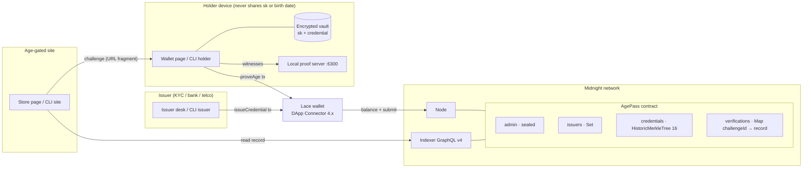
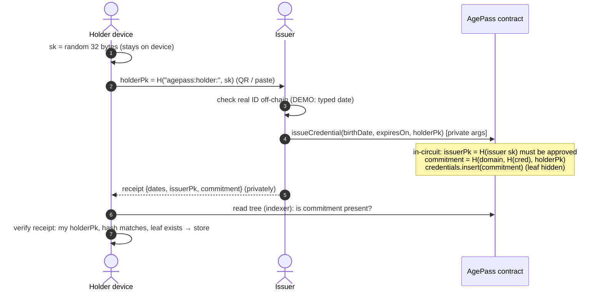
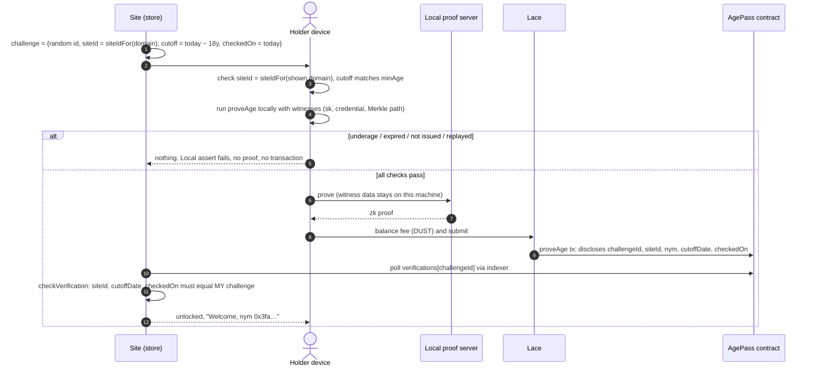

# AgePass architecture

## Components



Packages:

| Package     | Role                                                                                                                                                             |
| ----------- | ---------------------------------------------------------------------------------------------------------------------------------------------------------------- |
| `contract/` | `agepass.compact`, witnesses, compiler output, simulator and spec tests                                                                                          |
| `sdk/`      | Environment-neutral TypeScript: `AgePassAPI` over Midnight.js, hashing via pure circuits, challenges, verifier, receipts, dates, network config, friendly errors |
| `cli/`      | Node: wallet SDK fee wallet, encrypted level private state, `agepass` commands, `demo:local`/`e2e:local`, devnet compose                                         |
| `app/`      | React + Vite: wallet, issuer desk, demo store, explorer; Lace via DApp Connector 4.0.1; keys fetched from `public/`                                              |

## Issuance



## Verification



## Circuit `proveAge` in one picture

```mermaid
flowchart TD
  A[challengeId not yet answered?] -->|disclose challengeId| B
  B[commitment = H(cred, H(sk))] --> C[path = witness credentialPath(commitment)]
  C --> D{path.leaf == commitment?}
  D -->|yes| E{credentials.checkRoot(root(path))?<br/>disclose root only}
  E -->|yes| F{cred.birthDate ≤ cutoffDate?}
  F -->|yes| G{checkedOn ≤ cred.expiresOn?}
  G -->|yes| H[verifications.insert(challengeId, siteId, nym = H(sk, siteId), cutoffDate, checkedOn)]
  D -->|no| X[fail locally: nothing sent]
  E -->|no| X
  F -->|no| X
  G -->|no| X
```

## Key design choices

See `decisions.md` for the full ADR log. Highlights:

- Commitment computed **in-circuit** at issuance so the issuer key inside a credential is always
  the real issuer (ADR-001).
- Every hash TypeScript needs comes from **exported pure circuits** (`adminPublicKey`,
  `issuerPublicKey`, `holderPublicKey`, `sitePseudonym`, `credentialCommitment`, `siteIdFor`).
- `HistoricMerkleTree` so a holder's path stays valid while new credentials are issued.
- The site, not the circuit, checks that the record's dates match its own challenge.
