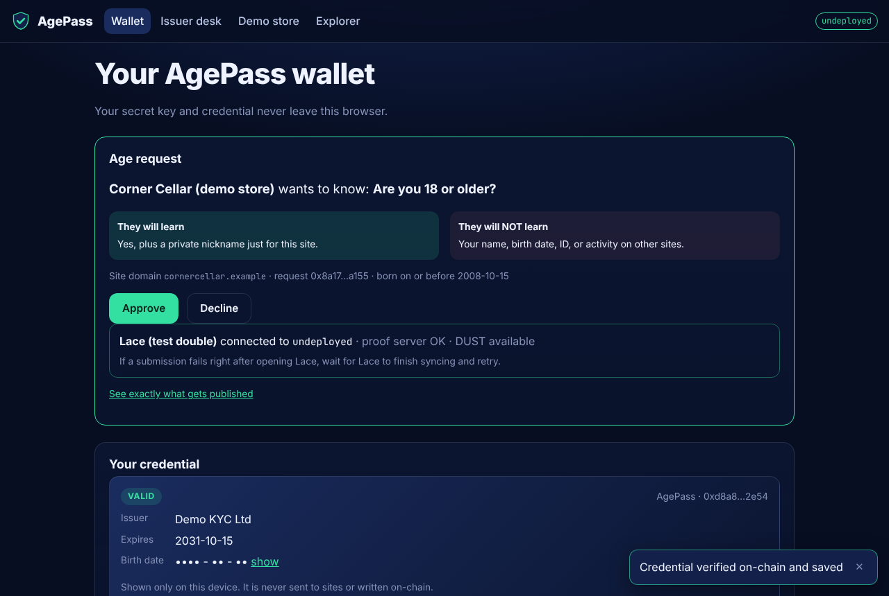
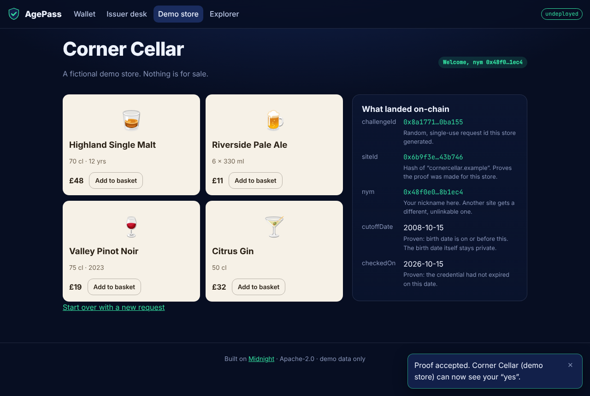

<!-- _class: lead -->

# AgePass

## Prove you’re 18+. **Not who you are.**

Zero-knowledge age checks on Midnight

Emediong Etuk Gregory · Midnight Network Buildathon · Wave 1

<!--
Hi, I'm Greg. AgePass lets anyone prove they're over 18 without showing an ID, using
zero-knowledge proofs on Midnight. Three minutes: the problem, how it works, a live demo, and
where it goes next.
-->

---

## The problem: age checks leak identities

- UK, EU, Australia and many US states now push platforms to **verify age**: social, gaming, dating, alcohol, betting.
- Today that means **uploading a passport or a face scan to every site**.
- Sites only need _yes or no_, but end up **holding full identities**: breached, sold, kept forever.
- Users drop off at the ID upload. Merchants carry liability they never wanted.

<!--
Every site that asks "are you 18?" ends up with your passport. That's a honeypot per site. The
question is binary; the data collected is not.
-->

---

## The solution in one sentence

**Verify once with a trusted issuer, then prove "18+" anywhere with a zero-knowledge proof: the site learns yes, plus a nickname that only works on that site.**

<!--
The issuer is someone who already does KYC: a bank, a telco. After that the holder's device does
all the work; nobody else ever sees the birth date again.
-->

---

## How it works

1. **Verify once.** The issuer checks your ID off-chain and adds a hidden commitment to a Merkle tree on Midnight. Birth date never goes on-chain.
2. **Prove anywhere.** A site asks “18+?”. Your device proves: I hold _some_ issued credential, it hasn’t expired, and my birth date ≤ the cutoff.
3. **Site learns “yes”.** Public record: site, the dates asked, and `nym = H(secret, site)`. Same site ⇒ same nym. Different sites ⇒ unlinkable.

<!--
Underage? The circuit fails on your own device before a proof exists. Nothing is sent. Not even
a failed transaction.
-->

---

## Privacy by design: what’s public, what isn’t

| Data                                                | On-chain?                                    |
| --------------------------------------------------- | -------------------------------------------- |
| Name, ID document                                   | Never collected                              |
| Birth date, expiry, holder secret, holder key       | **Never** (private inputs only)              |
| Which credential you used                           | **Never** (Merkle membership hides the leaf) |
| Approved issuers, credential count                  | Public (accountability)                      |
| challengeId, siteId, **nym**, cutoffDate, checkedOn | Public (the site’s “yes”)                    |

Tested: the spec suite and the local demo scan the raw public state for every private value.

<!--
Not a promise: a test. Spec 14 serializes the whole public state and transcript and asserts no
secret, key, birth date or commitment appears. The demo repeats that scan against a real node.
-->

---

## Why Midnight makes this possible

- **Dual ledger**: public `issuers`, `credentials`, `verifications` beside private keys and credentials that live only on the device.
- **`disclose()` boundaries** enforced by the compiler: every public value is explicit and commented.
- **ZK membership with `HistoricMerkleTree`**: proofs hide _which_ credential and survive new issuances.
- **Exported pure circuits**: TypeScript reuses the contract’s exact hashes.
- **Shielded DUST fees** and a **local proof server**: witness data never leaves the machine.

<!--
Without a dual-ledger chain you'd need a separate private database and trust its operator. Here
the privacy boundary is in the contract, checked by the compiler.
-->

---

## Architecture

<!--
One SDK for both CLI and web. Every hash comes from the contract's pure circuits, so TypeScript
and Compact can never disagree.
-->

---

## Demo

 

Approve → proof in ~30 s → store unlocks with a nym. A 16-year-old is stopped on-device: nothing sent.

<!--
Walk through: Corner Cellar asks, the wallet shows exactly what the site will and won't learn,
approve, proof in ~25 seconds, the store unlocks and shows the exact public record.
-->

---

## Testing and reliability

| Suite                                                                       | Result                              |
| --------------------------------------------------------------------------- | ----------------------------------- |
| Contract spec tests (simulator, no Docker)                                  | **33/33**                           |
| SDK tests (99% line coverage of helpers)                                    | **67/67**                           |
| `e2e:local` on a real local Midnight node                                   | **all checks pass**, 6 transactions |
| Every CLI command against the devnet                                        | **pass**                            |
| Browser E2E: issue + prove from Chromium on a local node                    | **pass**                            |
| CI on every push: compile (Compact 0.31.1), lint, licence, tests, app build | GitHub Actions                      |

<!--
Attacks covered: lying about the birth date, borrowing someone else's Merkle path, self-made
credentials, replay, laxer cutoffs from a malicious client, forged requests.
-->

---

## Market and business model

- **Who pays:** age-gated platforms and regulated merchants, **per verification**; cheaper than document checks, with no PII to secure.
- **Who earns:** issuers (banks, telcos, KYC providers) **per issuance**: new revenue from KYC they already did.
- **Users:** free.
- **GTM:** one issuer + one platform pilot → drop-in widget → issuer network.
- **Beyond age:** residency, student status, verified human.

<!--
The cheapest age check is the one you don't have to store. That's the pitch to merchants.
-->

---

## Roadmap

| Wave        | Scope                                                                                           |
| ----------- | ----------------------------------------------------------------------------------------------- |
| **1 (now)** | Contract, SDK, CLI, web app, local + Preview demo, tests, docs                                  |
| **2**       | “Verify with AgePass” JS widget · encrypted backup/restore · real revocation · fee sponsorship  |
| **3**       | More predicates (residency, student, human) · multiple issuers · pilot partner · device binding |

<!--
Wave 2 is all about making integration a one-day job for a site.
-->

---

<!-- _class: lead -->

## The ask

Try it: `npm ci && npm run compact && npm test`, then `npm run demo:local`

Looking for **an issuer** and **an age-gated platform** to pilot with.

**github.com/Emediong-Etuk/AgePass** · Built on Midnight · Apache-2.0

Live on Midnight Preview: `54fc78d8890099e2…221069d2`

<!--
Thanks. If you run a platform with an age gate, or you already do KYC, let's talk.
-->
